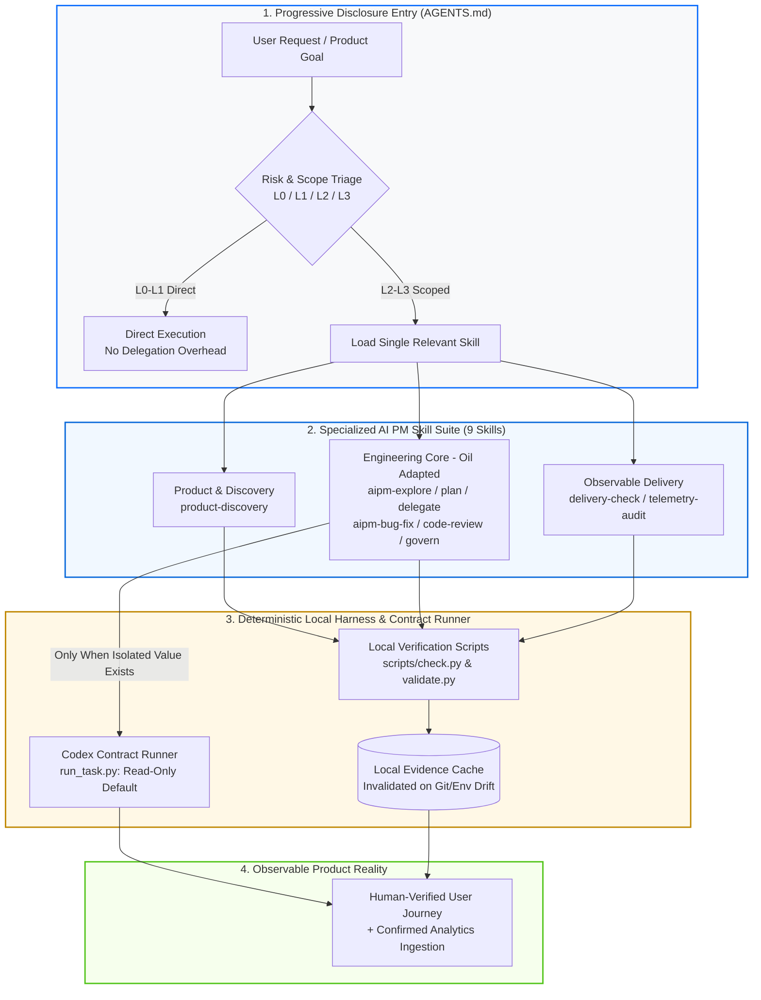

<div align="center">

# aipm-skills 🧭⚙️
### A Lightweight, Product-First Agent Harness & Skill Pack for AI PMs and Builders

[](https://www.python.org/)
[](https://github.com/openai/codex)
[](#)
[](#)
[](LICENSE)

*An evidence-driven AI PM development harness that translates product judgment into scoped execution, deterministic local checks, and observable user-facing delivery—without engineering bloat or runaway token tax.*

[Architecture](#-system-architecture) • [Why This Exists](#-the-problem-engineering-bloat-vs-product-velocity) • [The 9 Skills](#-the-9-skill-suite) • [Empirical Audit](#-empirical-token--workflow-audit) • [Quickstart](#-quickstart) • [Roadmap](#-roadmap)

---

</div>

## 📌 Executive Summary

Most open-source agent skill packs are built with a **heavyweight software-engineering mindset**—assuming large, long-horizon codebases, mandatory multi-agent delegation, and exhaustive verification loops. For an AI Product Manager (AI PM) or solo builder shipping rapid prototypes to validate user hypotheses, these defaults create severe friction: agents run lengthy experiments to answer trivial questions, trust passing unit tests while ignoring broken user journeys, and silently burn through context windows.

**`aipm-skills`** (`0.1.0-beta.2`) is a reusable, zero-dependency harness engineering standard distilled from building, deploying, and instrumenting a full end-to-end interactive web application (Vercel + PostHog) in rapid cycles. Built on the engineering foundation of [oil-oil/oil-dev-skills](https://github.com/oil-oil/oil-dev-skills) (for plan/execute separation) and informed by [addyosmani/agent-skills](https://github.com/addyosmani/agent-skills) (for delivery lifecycle), it restructures agent workflows around **product risk, progressive context disclosure, and observable user outcomes**.

---

## 🎯 The Problem: Engineering Bloat vs. Product Velocity

During end-to-end AI-native product delivery with Codex, three recurring failure modes surfaced that standard engineering skills failed to solve:

1. **Over-Verification on Low-Risk Decisions:** High-trust reasoning models naturally default to running lengthy gray-box experiments or full-repo scans to prove minor questions—decisions a PM should resolve in minutes through quick research.
   - *Fix:* Introduced **L0–L3 Risk-Scoped Planning** (`L0` short answer, `L1` small direct fix, `L2` conversational plan, `L3` formal spec) so execution effort scales strictly with product risk.
2. **The "Green Tests, Broken Experience" Blind Spot:** Coding agents equate a passing machine run or a successful deployment log with a finished product, overlooking missing end-states, edge cases, or unverified analytics ingestion.
   - *Fix:* Added dedicated **`delivery-check`** and **`telemetry-audit`** skills that separate *code complete* from *publicly accessible*, *user-journey verified*, and *backend-ingested*.
3. **Silent Context Tax & Bloated Skill Prompts:** Early AI-authored skills were overly verbose and lacked true progressive disclosure, causing massive context accumulation and slow responses without warning the user when to reset or hand off.
   - *Fix:* Stripped over **80% of redundant prompt prose** across entrypoints, enforced a strict `Entrypoint → Skill Body → On-Demand Reference` loading hierarchy, and offloaded deterministic checks (git diff scope, hash verification, test summaries) to local Python/CLI scripts.

---

## 🏗️ System Architecture



---

## 🧩 The 9-Skill Suite

Unlike rigid 6-stage pipelines that force every task through the same ceremony, `aipm-skills` treats `Define → Plan → Build → Verify → Review → Release` as **progress coordinates**, loading only the single skill needed for the current task.

| Domain | Skill | Purpose & Product-First Adaptation |
| :--- | :--- | :--- |
| **Product** | [`product-discovery`](skills/product-discovery/SKILL.md) | Structured product framing, direction trade-offs, and research records without conflating discovery notes with validated demand. |
| **Engineering** | [`aipm-explore`](skills/aipm-explore/SKILL.md) | Targeted codebase mapping and reuse discovery; replaces full-repository scans with scoped reads. |
| **Engineering** | [`aipm-plan`](skills/aipm-plan/SKILL.md) | **L0–L3 risk-tiered planning** and on-demand context handoff budgets (`context-handoff.md`). |
| **Engineering** | [`aipm-delegate`](skills/aipm-delegate/SKILL.md) | Codex-specific contract runner (`run_task.py`) for isolated execution when delegation genuinely saves context or improves review. |
| **Engineering** | [`aipm-bug-fix`](skills/aipm-bug-fix/SKILL.md) | Root-cause diagnosis before patching; blocks blind retry loops. |
| **Engineering** | [`aipm-code-review`](skills/aipm-code-review/SKILL.md) | Risk-weighted code review tailored to prototype vs. production stakes. |
| **Engineering** | [`aipm-govern`](skills/aipm-govern/SKILL.md) | Branch discipline (`feature/*` + PRs, no direct pushes to `main`), documentation sync, and deterministic repo hygiene. |
| **Delivery** | [`delivery-check`](skills/delivery-check/SKILL.md) | Separates "deployed" from "publicly accessible" and requires end-to-end user-journey acceptance (completion, failure recovery, next step). |
| **Delivery** | [`telemetry-audit`](skills/telemetry-audit/SKILL.md) | Enforces event-schema clarity, dev-traffic isolation, and backend ingestion verification—preventing false conclusions from raw event counts. |

---

## ⚡ Key Harness Engineering Decisions

- **Script Over Prompt (Deterministic Grounding):** Anything computable by a 20-line Python script—manifest validation, 46-file upstream SHA integrity checks, git whitespace checks, or unit test summaries—is executed locally via `scripts/check.py` rather than letting an LLM burn tokens guessing.
- **Content-Aware Evidence Caching:** Local verification results are reused only when input files, commands, environment, Git `HEAD`, working-tree diff, and whitespace config match exactly. Failed checks are never cached; CI and release gates always run fresh.
- **Codex Contract Runner (`run_task.py`):** Defaults to `read-only` mode (requiring explicit `implement` contracts for `workspace-write`), enforces `allowed_paths` as a working contract, binds resumed sessions to task/workspace/role/model tier, and refuses to silently swap models or treat truncated events as completion.
- **Human-Controlled Context Transitions:** Handoffs and new chat sessions are triggered by the user—not by rigid phase boundaries—while the agent surfaces phase progress, acceptance counts, and complexity warnings so the PM stays in control of context hygiene.

---

## 📊 Empirical Token & Workflow Audit

To ground the harness design in real usage rather than speculation, we audited the first 16 tasks of a complete prototype build prior to refactoring into `aipm-skills` (full de-sensitized breakdown in [`docs/cost-audit.md`](docs/cost-audit.md) and [`docs/validation.md`](docs/validation.md)):

| Metric | Observed Baseline (16 Prototype Tasks) | Harness Implication |
| :--- | :---: | :--- |
| **Cumulative Input Tokens** | **55,720,380** | Driven by repeated full-context reloads across long sessions. |
| **Cached Input Tokens** | **55,116,416 (98.9%)** | High cache hit rate masks massive context bloat and latency drag. |
| **Output Tokens** | **169,160** | Actual generation is <0.35% of total token volume. |
| **Tool Calls** | **263** | High-frequency exploratory reads that local scripts can collapse. |
| **Wall-Clock / Active Span** | **307.37 min / 114.62 min** | Highlights human-in-the-loop review and verification bottlenecks. |

### Verification Status & Honest Beta Boundaries
- **Verified Deterministically:** `python scripts/check.py --force` validates manifests, relative resource paths, licenses, 46 locked upstream file hashes (`upstream.lock.json`), git whitespace rules, and **20 deterministic unit tests** covering installer safety, conflict preservation, path rejection, sandbox flags, and cache invalidation.
- **Transparent Limitations:** Cross-project token savings and speedups are modeled as planning hypotheses—not claimed as proven benchmarks. The runner is tailored to Codex CLI (not a universal multi-runner abstraction), state writes are serialized, and `allowed_paths` acts as a working contract rather than a kernel-level filesystem sandbox.

---

## 🚀 Quickstart

Requires **Python 3.11+** (standard library only; zero third-party packages).

### 1. Verify the Pack Locally
```bash
git clone [https://github.com/Wenxuan-Luo11/aipm-skills.git](https://github.com/Wenxuan-Luo11/aipm-skills.git)
cd aipm-skills

# Run full deterministic check suite (manifests, 46 upstream hashes, 20 unit tests)
python scripts/check.py --force
```

### 2. Preview & Install into Your Project
The installer always defaults to dry-run preview, never overwrites modified files, and never mutates your existing `AGENTS.md`:
```bash
# Preview installation
python scripts/install.py --project /absolute/path/to/your-project

# Apply installation to .agents/skills/
python scripts/install.py --project /absolute/path/to/your-project --apply
```
Merge relevant rules from [`templates/AGENTS.project.md`](templates/AGENTS.project.md) into your project's `AGENTS.md`.

### 3. Preview a Codex Delegation Contract
```bash
# Dry-run contract validation (requires authenticated Codex CLI for live execution)
python skills/aipm-delegate/scripts/run_task.py --contract templates/task.example.json --dry-run
```

### 4. Safe Uninstall
Only files owned by the pack manifest and unmodified by you are removed:
```bash
python scripts/install.py --project /absolute/path/to/your-project --remove
python scripts/install.py --project /absolute/path/to/your-project --remove --apply
```

---

## 🗺️ Roadmap

1. **Eval-Driven Skill Iteration:** Build lightweight, repeatable prompt/skill eval suites (aligned with OpenAI and Anthropic eval practices) so every change to `AGENTS.md` or a `SKILL.md` is validated against real failure cases rather than intuition.
2. **Optional Starter Kit (Cross-IDE Portability):** Package a pluggable starter kit covering stack templates, CI deduplication, deployment, telemetry, and debugging so the harness transfers cleanly beyond Codex to other agentic IDEs.
3. **Optional Visual Harness:** Add a structured visual-acceptance layer covering design tokens, licensed asset checks, and UI state verification to close the gap between functional code and polished product craft.

---

## 📚 Documentation & Attribution

- **[Upstream Sources & Adaptations](docs/changes.md):** Full diff and rationale against `oil-oil/oil-dev-skills` and `addyosmani/agent-skills`.
- **[Anonymized Case Study](docs/case-study.md):** Product-delivery lessons abstracted from real prototyping cycles.
- **[Validation & Beta Limits](docs/validation.md):** Deterministic test coverage, behavioral probes, and known constraints.
- **[Cost & Token Audit](docs/cost-audit.md):** De-sensitized baseline token metrics and planning formulas.

**License:** New content is distributed under the **MIT License** ([`LICENSE`](LICENSE)). Derived `aipm-*` skills retain original upstream MIT notices ([`notices/OIL-MIT.txt`](notices/OIL-MIT.txt)), pinned snapshots, and `upstream.lock.json` integrity hashes.
